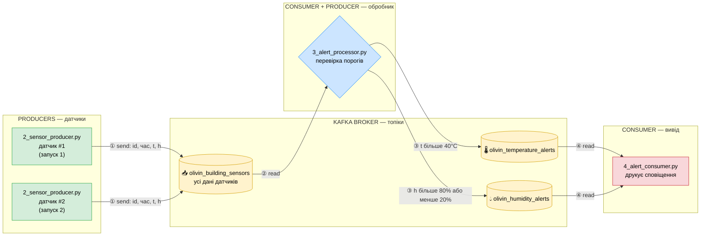
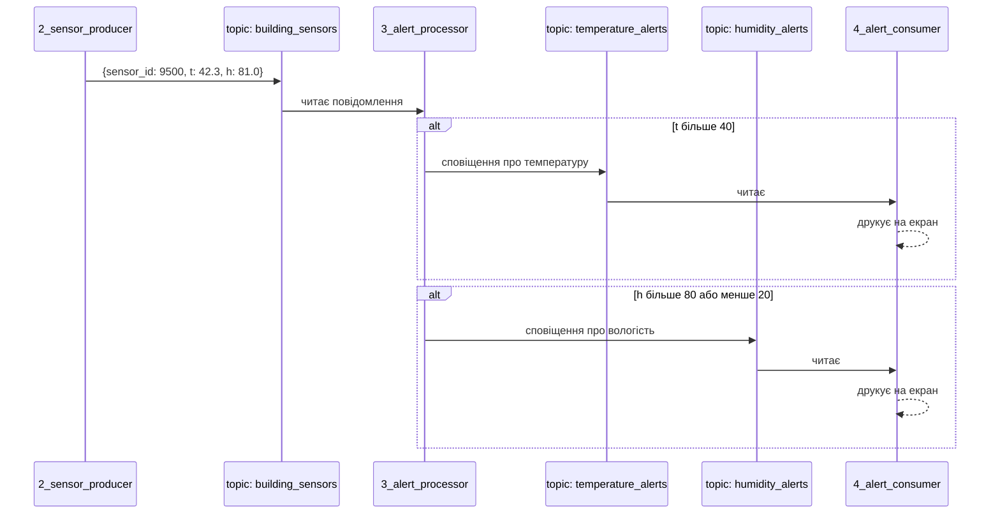
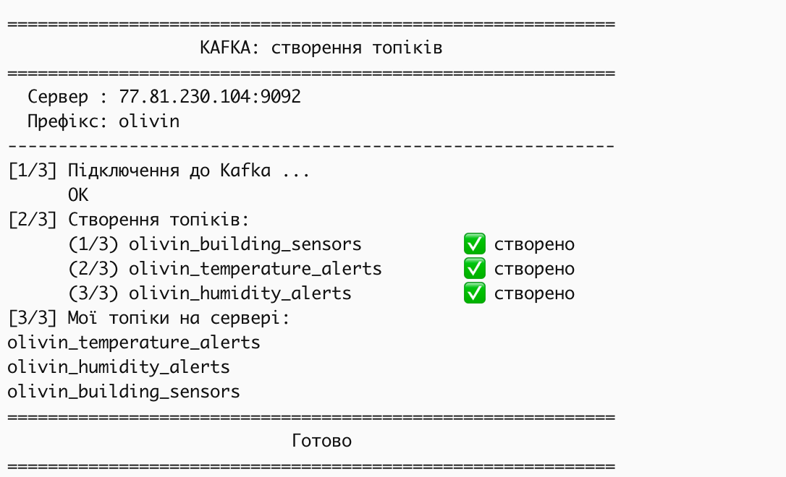
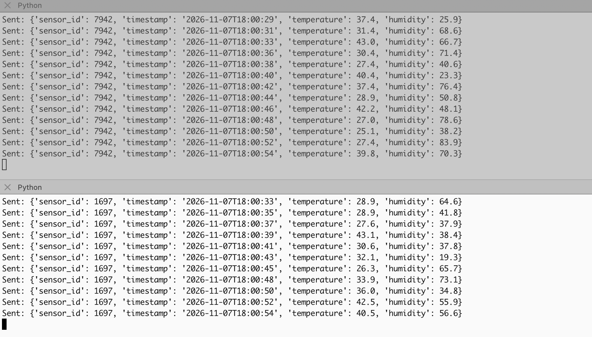
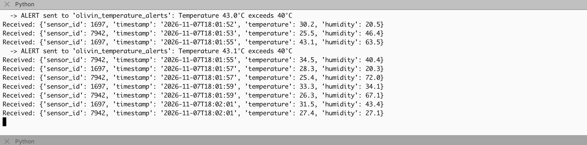
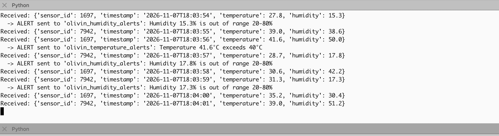
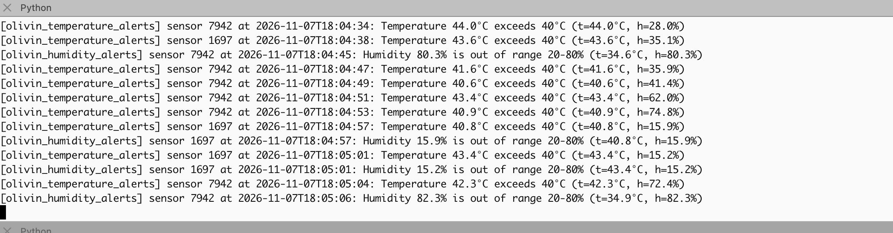
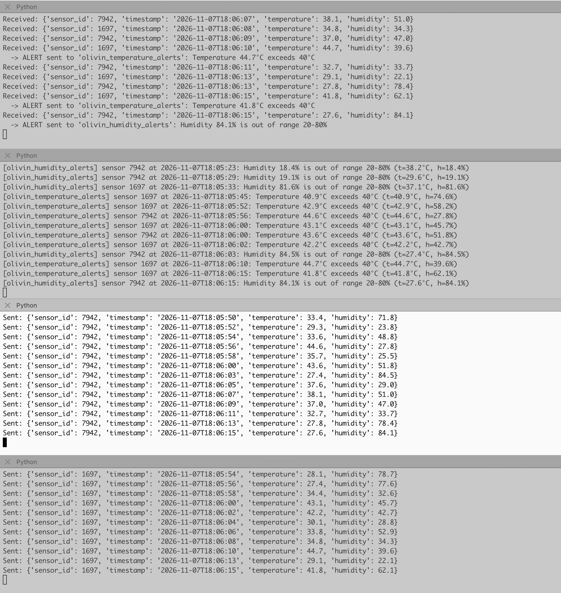

# Домашнє завдання: Apache Kafka (IoT-моніторинг)

Система збирає дані з датчиків температури та вологості і в реальному часі формує сповіщення про вихід показників за допустимі межі.

## Архітектура



**Що відбувається:**

1. **Producer** (`2_sensor_producer.py`) — кожен запуск = окремий датчик; кожні 2 с **записує** повідомлення в топік `building_sensors`.
2. **Обробник** (`3_alert_processor.py`) — це **consumer** для `building_sensors` і водночас **producer** для топіків сповіщень: читає кожне повідомлення та перевіряє пороги.
3. Якщо поріг перевищено — обробник **записує** сповіщення у `temperature_alerts` та/або `humidity_alerts`; нормальні дані далі не йдуть.
4. **Consumer** (`4_alert_consumer.py`) — **читає** обидва топіки сповіщень і виводить їх на екран.

Топіки (жовті) — це «черги» всередині Kafka: скрипти не спілкуються напряму, лише пишуть у топік або читають із нього.

### Послідовність для одного повідомлення



| Файл | Призначення |
|---|---|
| `configs.py` | параметри підключення до Kafka та імена топіків (префікс `olivin`) |
| `1_create_topics.py` | створює 3 топіки та виводить їх список |
| `2_sensor_producer.py` | імітує один датчик: кожні 2 с шле `sensor_id`, `timestamp`, `temperature` (25–45), `humidity` (15–85) |
| `3_alert_processor.py` | читає дані датчиків; t > 40°C → `temperature_alerts`; h > 80% або h < 20% → `humidity_alerts` |
| `4_alert_consumer.py` | читає обидва топіки сповіщень і виводить їх на екран |

## Запуск

```bash
python3 -m venv .venv && source .venv/bin/activate
pip install -r requirements.txt
python 1_create_topics.py
python 3_alert_processor.py     # окремий термінал
python 4_alert_consumer.py      # окремий термінал
python 2_sensor_producer.py     # 2+ терміналів — кожен запуск = окремий датчик
```

## Результати

### 1. Створення трьох топіків

Скрипт `1_create_topics.py` підключається до Kafka і створює три топіки з префіксом `olivin`. У блоці `[3/3]` — результат команди `[print(topic) for topic in admin_client.list_topics() if MY_NAME in topic]`: на сервері є всі три топіки.



### 2. Генерація даних двома датчиками одночасно → `building_sensors`

`2_sensor_producer.py` запущено двічі в різних терміналах — це два незалежні датчики з ID **7942** (верхня панель) і **1697** (нижня). Кожен кожні ~2 с надсилає в `olivin_building_sensors` ID, час, температуру (25–45) і вологість (15–85). Час повідомлень збігається — програми працюють одночасно.



### 3. Отримання та фільтрація даних

`3_alert_processor.py` читає з `olivin_building_sensors` повідомлення обох датчиків (`Received: ...`) і перевіряє кожне на пороги. Більшість даних у нормі й далі не йдуть; рядок `-> ALERT` з'являється лише тоді, коли поріг перевищено (наприклад, температура 43.0°C і 43.1°C більше 40°C).



### 4. Відправка відфільтрованих даних у `temperature_alerts` та `humidity_alerts`

Видно, що відфільтровані дані потрапляють у різні топіки залежно від причини:
- вологість 15.3%, 17.8%, 17.3% (менше 20%) → `olivin_humidity_alerts`;
- температура 41.6°C (більше 40°C) → `olivin_temperature_alerts`.



### 5. Отримання сповіщень та виведення на екран

`4_alert_consumer.py` підписаний на обидва топіки сповіщень і виводить кожне: з якого топіку, ID датчика, час, повідомлення про перевищення та значення показників. Є сповіщення з обох топіків і від обох датчиків.



### Загальний вигляд — усі 4 програми одночасно

Зверху вниз: обробник (`3_alert_processor.py`), читач сповіщень (`4_alert_consumer.py`), датчик 7942 і датчик 1697. Можна простежити одне повідомлення наскрізь: датчик 1697 о `18:06:10` надіслав t=44.7°C → обробник відправив `ALERT` у `temperature_alerts` → читач вивів це сповіщення.



## Висновок

Реалізовано повний потоковий конвеєр на Kafka: кілька незалежних продюсерів-датчиків, обробник, який фільтрує дані та публікує сповіщення в окремі топіки, і споживач, що виводить сповіщення в реальному часі.
